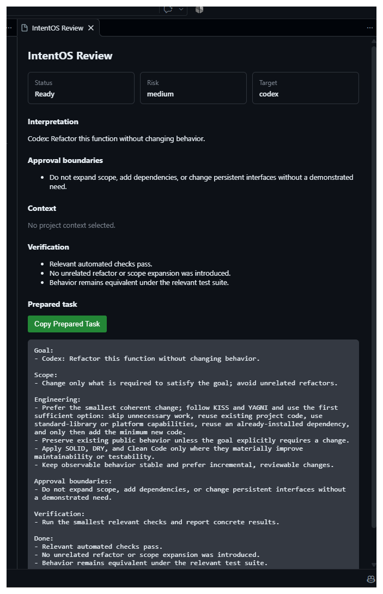

# IntentOS for VS Code

Install [IntentOS from the Visual Studio Marketplace](https://marketplace.visualstudio.com/items?itemName=milad-seyfi.intentos-vscode). The extension turns a rough engineering request into a bounded task you can review before handing it to an AI assistant.

## Install the IntentOS CLI

The extension requires the local IntentOS CLI. Install it with:

```bash
python -m pip install intentos-engineering
```

Confirm that `intentos` is available in the environment used by VS Code:

```bash
intentos --help
```

## Use the extension

1. Select a request in an editor, or leave text unselected to enter a request when prompted.
2. Click **IntentOS** in the VS Code status bar, or open the Command Palette and run **IntentOS: Prepare Task**.
3. Review the interpretation, risk, approval boundaries, context summary, and verification guidance.
4. Choose **Copy Prepared Task**.
5. Paste the prepared task into Codex, ChatGPT, Claude, Gemini, Cursor, or another AI tool.

The status bar is the easy entry point; the Command Palette remains available for keyboard-oriented use.



The extension does not send the task to an AI tool or execute it.

## Configuration

`intentos.executable` defaults to `intentos`. Set it to a full executable path when VS Code cannot find your CLI. For example, on Windows:

```json
{
  "intentos.executable": "C:\\Users\\you\\project\\.venv\\Scripts\\intentos.exe"
}
```

## Privacy and limits

- The extension invokes the local IntentOS CLI. It has no telemetry or hosted backend.
- It does not automatically crawl repository files or collect project context.
- The extension does not require AI-provider credentials and does not autonomously execute or send tasks.
- It provides one prepare, review, and copy workflow; it does not include a sidebar, agent-specific send action, or MCP client.

## Development

To work on this extension, clone the [IntentOS repository](https://github.com/milad-seify/IntentOS), open its root folder in VS Code, and press **F5** to start the Extension Development Host. Run **IntentOS: Prepare Task** in that window. The root repository's launch configuration opens the workspace and points VS Code at this extension directory.

The extension is a thin adapter over the shared IntentOS CLI/core. See the repository's [dogfooding guide](../../docs/VSCODE_DOGFOODING.md) for the manual acceptance cases.
