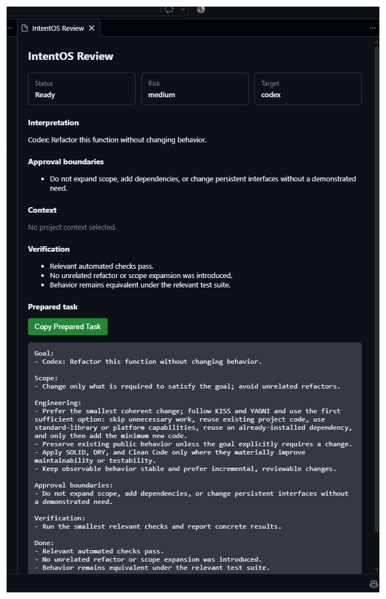

# IntentOS for VS Code

Install [IntentOS from the Visual Studio Marketplace](https://marketplace.visualstudio.com/items?itemName=milad-seyfi.intentos-vscode). The extension turns a rough engineering request into a bounded task you can review before handing it to an AI assistant.

## Install the IntentOS CLI

The extension requires the local IntentOS CLI. Install it with:

```bash
python -m pip install intentos-engineering
```

Confirm that `intentos` is available in the environment used by VS Code:

```bash
intentos --help
```

## Prepare a task

1. Select a request in an editor, or leave text unselected to enter a request when prompted.
2. Click **IntentOS** in the VS Code status bar, or open the Command Palette and run **IntentOS: Prepare Task**.
3. Review the interpretation, risk, approval boundaries, context summary, and verification guidance.
4. Choose **Copy Prepared Task**.
5. Paste the prepared task into Codex, ChatGPT, Claude, Gemini, Cursor, or another AI tool.

The status bar and Command Palette remain available for keyboard-oriented use. The published Marketplace `0.1.1` release contains this basic flow.



The basic flow does not send the task to an AI tool or execute it.

## Development workbench

The current source candidate adds an **IntentOS** Activity Bar entry. Choose **Open workbench** to get a larger native-themed view:

- **Start:** prepare, clarify, review risk/context/approvals/verification and copy the result.
- **Project:** review explicitly selected project sources and their provenance.
- **Govern:** preview status, decision and scope changes, or review requirement/readiness evidence.
- **Delegate:** inspect a route, prepare a portable handoff packet, or preview supported Codex dispatch.
- **Recover:** create or review a checkpoint against selected context and external operation evidence.
- **Outcomes:** record, compare and learn from caller-supplied evidence.

These screens require the unpublished Core `1.1.0` source candidate CLI; the public Core `1.0.1` package lacks the advanced commands. Files are selected explicitly with the VS Code picker. Project writes and Codex dispatch require an exact CLI preview and a separate modal approval. An agent turn is never proof of a verified result. See [the UI contract](../../docs/UX.md) and [graphical coverage matrix](../../docs/SIMPLE_UI.md).

Drafts and chosen files remain only in this workbench panel's memory while you navigate. Close the panel or choose **Clear session drafts** to remove them. A previous review is labeled and requires a new preview before approval. Errors appear beside the action and receive keyboard focus; controls recover after failure. **File format and example** explains the advanced evidence inputs and can save a conservative JSON starting point through a native save dialog. Replace its placeholders with real evidence; it supplies no approval or observed outcome. Portable handoffs show readable instructions with Copy as well as the saved packet, and exact technical results stay expandable.

## Configuration

`intentos.executable` defaults to `intentos`. Set it to a full executable path when VS Code cannot find your CLI. For example, on Windows:

```json
{
  "intentos.executable": "C:\\Users\\you\\project\\.venv\\Scripts\\intentos.exe"
}
```

## Privacy and limits

- The extension invokes the local IntentOS CLI. It has no telemetry or hosted backend.
- It does not automatically crawl repository files or collect project context.
- Basic preparation does not require AI-provider credentials. The development workbench supports only the existing approval-bound Codex dispatch and manual handoff for other targets.
- It has no MCP client, telemetry or hosted backend.

## Development

To work on this extension, clone the [IntentOS repository](https://github.com/milad-seify/IntentOS), open its root folder in VS Code, and press **F5** to start the Extension Development Host. Run **IntentOS: Prepare Task** in that window. The root repository's launch configuration opens the workspace and points VS Code at this extension directory.

The extension is a thin adapter over the shared IntentOS CLI/core. See the repository's [dogfooding guide](../../docs/VSCODE_DOGFOODING.md) for the manual acceptance cases.
